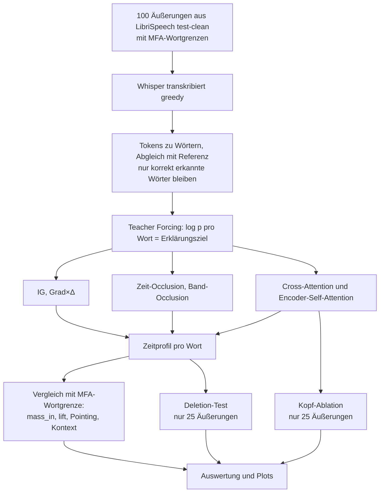

# Projektskript: Wo hört Whisper hin?

Dieses Dokument erklärt das gesamte Projekt als Lesetext: den fachlichen Hintergrund, jede Zelle des Notebooks [`whisper_xai.ipynb`](whisper_xai.ipynb), alle Metriken und alle Ergebnisse. Es ist so geschrieben, dass man das Projekt auch ohne Vorwissen über Whisper oder Erklärbare KI (XAI) nachvollziehen kann.

Die kompakten Dokumente dazu:

* [`README (2).md`](README%20(2).md): Fragestellung, Methoden, Quellen.
* [`Ergebnisse.md`](Ergebnisse.md): Zahlen und Tabellen aller Ergebnisse.

Dieses Skript ergänzt sie um Erklärungen und Begründungen. Zahlen, die hier genannt werden, stammen aus `results/` bzw. aus `Ergebnisse.md`. Werte mit „ca.“ sind aus Abbildungen abgelesen.

## Inhaltsverzeichnis

1. [Das Projekt in einem Absatz](#1-das-projekt-in-einem-absatz)
2. [Hintergrund: Spracherkennung und Whisper](#2-hintergrund-spracherkennung-und-whisper)
3. [Hintergrund: Erklärbare KI (XAI)](#3-hintergrund-erklärbare-ki-xai)
4. [Daten: LibriSpeech und Forced Alignment](#4-daten-librispeech-und-forced-alignment)
5. [Der Versuchsaufbau im Überblick](#5-der-versuchsaufbau-im-überblick)
6. [Das Notebook Zelle für Zelle](#6-das-notebook-zelle-für-zelle)
7. [Die Metriken verständlich erklärt](#7-die-metriken-verständlich-erklärt)
8. [Die Ergebnisse erklärt](#8-die-ergebnisse-erklärt)
9. [Das Gesamtbild](#9-das-gesamtbild)
10. [Grenzen, Fallstricke und was man anders machen könnte](#10-grenzen-fallstricke-und-was-man-anders-machen-könnte)
11. [Umgebung, Laufzeit und Dateien](#11-umgebung-laufzeit-und-dateien)
12. [Glossar](#12-glossar)

---

## 1 Das Projekt in einem Absatz

Whisper ist ein Spracherkennungsmodell von OpenAI. Es nimmt eine Audioaufnahme und gibt Text aus. Wir fragen: **Welche Stellen im Audio braucht Whisper, um ein bestimmtes Wort zu erkennen?** Die naheliegende Antwort ist „die Stelle, an der das Wort gesprochen wird“. Ob das stimmt, lässt sich prüfen, weil es für Sprachdaten eine objektive Referenz gibt: Ein Programm namens Montreal Forced Aligner (MFA) hat für jedes Wort die Start- und Endzeit bestimmt. Wir vergleichen deshalb, wo verschiedene Erklärungsmethoden die Wichtigkeit im Audio verorten, mit diesen Wortgrenzen. Als Erklärungsmethoden dienen Gradienten (Integrated Gradients, Gradient×Δ), Ausblendtests (Occlusion) und die Aufmerksamkeitsgewichte (Attention) des Modells. Außerdem prüfen wir per Eingriffe ins Modell (Frames löschen, Attention-Köpfe abschalten), ob diese Erklärungen auch **kausal** stimmen, also ob das Modell wirklich von diesen Stellen und Köpfen abhängt.

---

## 2 Hintergrund: Spracherkennung und Whisper

### 2.1 Automatische Spracherkennung (ASR)

ASR (Automatic Speech Recognition) wandelt gesprochene Sprache in Text um. Moderne Systeme sind neuronale Netze, die direkt aus dem Audiosignal einen Text erzeugen. Whisper (Radford et al., 2023) wurde auf etwa 680.000 Stunden Audio trainiert und funktioniert deshalb auch ohne Feinabstimmung auf vielen Sprachen und Aufnahmebedingungen.

### 2.2 Vom Audio zum Spektrogramm

Ein neuronales Netz bekommt nicht die rohe Wellenform, sondern ein **Log-Mel-Spektrogramm**:

1. Das Audio (hier 16.000 Abtastwerte pro Sekunde) wird in kurze Fenster geschnitten (25 ms Länge, alle 10 ms ein neues Fenster).
2. Pro Fenster wird per Fourier-Transformation berechnet, wie viel Energie in welcher Frequenz steckt.
3. Die Frequenzen werden auf die **Mel-Skala** abgebildet, die sich am menschlichen Hören orientiert: Tiefe Frequenzen werden fein, hohe grob aufgelöst. Whisper nutzt 80 Mel-Bänder.
4. Die Energie wird logarithmisch dargestellt (Lautstärke wird ebenfalls logarithmisch wahrgenommen).

Das Ergebnis ist eine Matrix mit **80 Zeilen (Frequenzbänder)** und einer Spalte pro 10 ms (**Frames**). Genau diese Matrix $X \in \mathbb{R}^{80\times 3000}$ ist die „Eingabe“, für die wir Wichtigkeit berechnen.

### 2.3 Die 30-Sekunden-Eigenheit

Whisper verarbeitet **immer genau 30 Sekunden**. Kürzere Aufnahmen werden mit Stille aufgefüllt (Padding), längere werden geteilt. 30 s ergeben 3000 Frames à 10 ms. Das hat zwei Folgen für unser Projekt:

* Bei einer 8 s langen Äußerung bestehen mehr als zwei Drittel der Eingabe aus Padding. Ein Wort muss in diesem großen Feld lokalisiert werden, deshalb ist das Zufallsniveau für Lokalisierung sehr klein (ca. 4 %).
* Das Padding kann vom Modell als „Ablageplatz“ für Aufmerksamkeit genutzt werden. Das sehen wir bei den *Attention Sinks* wieder.

Auch die „Stille“, die wir später als Baseline verwenden, ist genau dieses Padding (siehe Abschnitt 3.3).

### 2.4 Encoder und Decoder

Whisper ist ein **Encoder-Decoder-Transformer**:

* Der **Encoder** liest das Spektrogramm. Zwei Faltungsschichten (die zweite mit Schrittweite 2) halbieren die Zeitauflösung auf **1500 Frames à 20 ms**. Danach folgen Transformer-Schichten mit **Self-Attention**: Jeder Zeitpunkt kann auf jeden anderen schauen. Das Ergebnis ist pro 20 ms ein Vektor, der den Audioinhalt in diesem Moment im Kontext des ganzen Audios beschreibt.
* Der **Decoder** erzeugt den Text Token für Token (autoregressiv). In jeder Schicht gibt es neben einer Self-Attention über die schon erzeugten Tokens eine **Cross-Attention** auf die Encoder-Ausgabe: Der Decoder fragt „welche Audiostelle ist für das nächste Token relevant?“.

Die Größen der beiden Modelle in diesem Projekt (aus dem Notebook-Ausgabe):

| | whisper-tiny | whisper-base |
|---|---|---|
| Encoder: Schichten × Köpfe | 4 × 6 | 6 × 8 |
| Decoder: Schichten × Köpfe | 4 × 6 | 6 × 8 |

Ein **Kopf** (Head) ist ein Teil einer Attention-Schicht. Jede Schicht teilt ihre Attention in mehrere parallele Köpfe, die jeweils unterschiedliche Muster lernen können.

### 2.5 Tokens und Wörter

Der Decoder erzeugt keine ganzen Wörter, sondern **BPE-Tokens** (Byte-Pair-Encoding), das sind Wortteile. „explanation“ kann z. B. aus mehreren Tokens bestehen. Ein Token, das mit einem Leerzeichen beginnt, startet ein neues Wort. Das Notebook fasst Tokens deshalb wieder zu Wörtern zusammen, denn Wortgrenzen liefert nur der Aligner auf Wortebene.

Jede Ausgabe beginnt mit festen Steuer-Tokens: `<|startoftranscript|>`, `<|en|>` (Sprache), `<|transcribe|>` (Aufgabe) und `<|notimestamps|>` (keine Zeitstempel). Am Ende steht `<|endoftext|>`.

### 2.6 Teacher Forcing

Beim normalen Erzeugen (Generieren) füttert das Modell seine Ausgaben schrittweise zurück. Beim **Teacher Forcing** gibt man dem Decoder die komplette Zielsequenz auf einmal und liest ab, wie wahrscheinlich das Modell jedes Token findet. Das geht in einem einzigen Durchlauf und liefert das, was wir für Gradienten brauchen: die Wahrscheinlichkeit eines Tokens als Funktion der Eingabe. Wir setzen als Ziel Whispers **eigene** Transkription ein.

### 2.7 Alignment Heads und DTW

OpenAI hat bei Whisper für jede Modellgröße ein paar Cross-Attention-Köpfe festgelegt, die sich besonders gut für Wort-Zeitstempel eignen (*alignment heads*). Daraus wird mit **Dynamic Time Warping (DTW)** eine monotone Zuordnung von Tokens zu Zeit berechnet. Unsere Frage dazu: Lokalisieren genau diese Köpfe wirklich gut? Und sind sie auch kausal wichtig für die Erkennung?

---

## 3 Hintergrund: Erklärbare KI (XAI)

### 3.1 Was ist eine Attribution?

Ein neuronales Netz ist eine Funktion $f$. Hier ist $f(X)$ die **Log-Wahrscheinlichkeit**, die Whisper einem Wort gibt:

$$f(X) = \log p(\text{Wort}\mid X) = \sum_{t\in\text{Wort}} \log p(y_t \mid y_{<t}, X)$$

Eine **Attribution** weist jedem Eingabewert (hier jeder der $80\times3000$ Spektrogrammzellen) eine Zahl zu: Wie sehr hat dieser Wert zu $f(X)$ beigetragen? Fasst man die Attribution über die Frequenzachse zusammen, erhält man ein **Zeitprofil**: Welche Zeitpunkte sind wichtig?

### 3.2 Post-hoc-Analyse

„Post hoc“ heißt: Das Modell wird nicht verändert oder neu trainiert, sondern nachträglich untersucht. Alle Methoden hier greifen nur von außen auf das fertige Modell zu.

### 3.3 Die Baseline („Stille“)

Fast alle Attributionsmethoden vergleichen die Eingabe mit einer **Baseline** $X_0$ („Was wäre ohne dieses Signal?“). Die Wahl der Baseline beeinflusst das Ergebnis stark. Eine Matrix aus Nullen wäre für Whisper kein sinnvolles Spektrogramm. Deshalb nutzt das Projekt das **Padding-Spektrum der jeweiligen Äußerung**: Der Feature-Extractor beschneidet Log-Mel-Werte nach unten bei (Maximum − 8). Aufgefüllte Nullen landen genau auf diesem Mindestwert. Die Baseline ist also exakt das, was Whisper als Stille kennt, und keine unnatürliche Eingabe.

Im Code ist das eine einzige Zeile: `baseline = feats[..., -1:].expand_as(feats)`. Der letzte Frame ist garantiert Padding (alle Äußerungen sind ≤ 15 s, das Feld hat 30 s) und wird auf die ganze Matrix kopiert.

### 3.4 Die Erklärungsmethoden

**Integrated Gradients (IG)** (Sundararajan et al., 2017). Man geht in vielen kleinen Schritten von der Baseline zur echten Eingabe und summiert die Gradienten auf diesem Weg auf:

$$\mathrm{IG}_i = (x_i - x_{0,i}) \cdot \int_0^1 \frac{\partial f(x_0 + \alpha (x - x_0))}{\partial x_i}\, d\alpha$$

Das Integral wird durch `ig_steps = 32` Stützstellen (Mittelpunktsregel) angenähert. IG erfüllt das Axiom der **Completeness**: Die Summe aller Attributionen ergibt exakt den Unterschied $f(x) - f(x_0)$. Daran lässt sich prüfen, ob die Näherung gut genug ist.

Warum nicht einfach den Gradienten am Punkt $x$? Bei Sättigung (das Netz ist an der Stelle „schon sicher“) ist der Gradient nahe null, obwohl die Eingabe wichtig ist. IG vermeidet das, weil es den ganzen Weg betrachtet.

**Gradient × Δ** (Shrikumar et al., 2016). Der Gradient nur am Endpunkt, multipliziert mit $(x - x_0)$. Das ist IG mit einer einzigen Stützstelle: billig, aber bei Sättigung ungenau.

**Occlusion** (Zeiler & Fergus, 2014). Man verdeckt einen Teil der Eingabe (setzt ihn auf die Baseline) und misst, wie stark $f$ fällt. Das ist modellagnostisch (man braucht keine Gradienten) und **kausal** im Sinne eines Eingriffs. Hier verdecken wir ein 100-ms-Fenster, das in 50-ms-Schritten über das Audio wandert. Für jedes Fenster wird der Abfall pro Wort gemessen und danach pro Frame gemittelt.

**Band-Occlusion.** Wie oben, aber es werden nur bestimmte Frequenzbänder im Wortsegment (±50 ms) verdeckt. Das beantwortet, welche Frequenzen für ein Wort wichtig sind.

**Attention als Erklärung.** Die Aufmerksamkeitsgewichte sind verlockend: Sie sind direkt im Modell sichtbar und zeigen, welche Teile der Eingabe ein Kopf „anschaut“. Aber **Attention ist nicht automatisch Wichtigkeit** (Jain & Wallace, 2019; Wiegreffe & Pinter, 2019). Ein Kopf kann auf eine Stelle schauen, ohne dass das die Ausgabe wesentlich verändert. Deshalb prüfen wir Attention gesondert mit Eingriffen (Ablation).

### 3.5 Wie prüft man, ob eine Erklärung stimmt?

* **Vergleich mit einer Referenz** (hier: Wortgrenzen). Das ist **Plausibilität**: Erklärt die Methode so, wie wir es erwarten?
* **Deletion-Test** (Samek et al., 2017). Man entfernt die laut Methode wichtigsten Teile der Eingabe und misst, wie stark die Ausgabe leidet. Eine gute Erklärung findet die wirklich wichtigen Teile, die Ausgabe bricht also schnell ein. Das ist **Faithfulness** (Treue): Gibt die Erklärung das tatsächliche Modellverhalten wieder?
* **Kopf-Ablation** (Michel et al., 2019). Man schaltet einen Attention-Kopf ab (Ausgabe auf 0) und misst die Folgen.

Plausibel ist nicht dasselbe wie treu. Eine Erklärung kann menschlich einleuchtend sein, aber nichts mit dem Modellverhalten zu tun haben, und umgekehrt. Genau deshalb enthält das Projekt beide Prüfungen.

### 3.6 Das Out-of-Distribution-Problem

Wenn man Teile der Eingabe löscht, entstehen Spektrogramme, die das Modell im Training nie gesehen hat (Hooker et al., 2019). Ein Abfall von $\log p$ kann dann teilweise daran liegen, dass das Modell „irritiert“ ist, und nicht daran, dass die gelöschte Information fehlt. Die Stille-Baseline mildert das, denn Stille kommt in echten Aufnahmen ständig vor, beseitigt es aber nicht ganz.

---

## 4 Daten: LibriSpeech und Forced Alignment

**LibriSpeech** (Panayotov et al., 2015) ist ein Korpus vorgelesener englischer Hörbücher. Der Teil `test-clean` enthält saubere Aufnahmen mit exakten Texttranskripten. Wir nutzen ihn über den Hugging-Face-Datensatz `gilkeyio/librispeech-alignments`.

**Forced Alignment.** Wenn man den gesprochenen Text kennt, kann ein Aligner berechnen, wann welches Wort gesprochen wird. Der **Montreal Forced Aligner (MFA)** (McAuliffe et al., 2017) erzeugt Wort- und Phonem-Grenzen. Der genannte Datensatz enthält diese Alignments (Lugosch et al., 2019).

Diese Wortgrenzen sind unsere **Referenz** („Ground Truth“). Man sollte sie aber nicht überschätzen: Sie sind selbst modellbasiert, und die Genauigkeit liegt bei etwa 10–20 ms, ungefähr einem Phonem. Deshalb gibt es eine Toleranz beim Pointing Game (20 ms).

Der Datensatz hat vier Spalten, die wir benutzen: `audio`, `words` (Liste aus Wort, Start, Ende), `id`, `transcript`. Das Notebook streamt nur den Split `test_clean` (2620 Äußerungen im Datensatz), mischt ihn mit festem Seed und nimmt die ersten Äußerungen, die ≤ 15 s lang sind und mindestens 3 Wörter haben. So ergeben sich 100 Äußerungen.

---

## 5 Der Versuchsaufbau im Überblick

Die Fragen dahinter, in der Reihenfolge der Teilfragen (TF):

| TF | Frage | Hypothese |
|---|---|---|
| TF1 | Liegt die Relevanz zeitlich im Wortsegment? | H1 |
| TF2 | Welche Frequenzen sind wichtig? | (explorativ) |
| TF3 | Welche Cross-Attention-Köpfe lokalisieren, und sind es die Alignment-Köpfe? | H2 |
| TF4 | Wie arbeiten die Encoder-Köpfe in den Schichten? | H3 |
| TF5 | Stimmen die Erklärungen kausal (Deletion, Ablation)? | H4 |
| Skalierung | tiny gegen base | – |

---

## 6 Das Notebook Zelle für Zelle

Die Nummerierung folgt den Abschnittsüberschriften im Notebook. Zeilenangaben fehlen absichtlich, es geht um das Prinzip.

### Abschnitt 0 – Titel und Installation

Die erste Markdown-Zelle fasst Forschungsfrage und Teilfragen zusammen. Die zweite Zelle installiert Pakete per `%pip`. Die Zelle ist für Colab gedacht. Im lokalen venv ist sie meist unnötig, weil die Pakete schon installiert sind. Wichtig: Das Notebook importiert zusätzlich `torch`, `numpy`, `pandas`, `matplotlib` und `scipy`. Diese stehen nicht in der `%pip`-Zeile und müssen in der Umgebung vorhanden sein (siehe Abschnitt 11).

### Abschnitt 0b – Imports und Konfiguration

* Wichtige Importe: `torch` (neuronale Netze, Gradienten), `transformers` (Whisper), `datasets` (LibriSpeech), `soundfile` und `librosa` (Audio laden und umtakten), `scipy.stats` (Tests), `pandas` und `matplotlib` (Tabellen und Plots).
* `DEVICE` wählt GPU, falls vorhanden, sonst CPU. In diesem Projekt lief alles auf CPU.
* `SEED = 0` setzt alle Zufallsgeneratoren fest, damit die Auswahl der Äußerungen und die Zufallsbaselines reproduzierbar sind.
* `QUICK = False`: Mit `True` läuft nur ein Mini-Test (10 Äußerungen, 3 für Deletion und Ablation).
* `CFG` ist ein Dictionary mit allen Parametern:

| Parameter | Bedeutung |
|---|---|
| `models` | zu vergleichende Modelle |
| `n_utt` | Anzahl der Äußerungen (100) |
| `n_faith` | Teilmenge für die teuren Faithfulness-Tests (25) |
| `max_dur` | maximale Äußerungsdauer (15 s) |
| `ig_steps`, `ig_batch` | Stützstellen und Batchgröße für IG |
| `occ_win`, `occ_stride` | Occlusion-Fenster und Schrittweite |
| `n_bands` | Anzahl Frequenzbänder bei der Band-Occlusion |
| `tol` | Toleranz für das Pointing Game (20 ms) |
| `ctx` | Länge des Kontextfensters vor/nach dem Wort (300 ms) |
| `del_fracs` | Löschanteile im Deletion-Test |
| `batch` | Batchgröße für Forward-Durchläufe ohne Gradient |
| `ablation_wer` | ob bei der Ablation auch die WER per Generierung gemessen wird |

* Konstanten: `SR = 16000` (Abtastrate), `HOP = 0.01` (10 ms pro Spektrogramm-Frame), `ENC_HOP = 0.02` (20 ms pro Encoder-Frame), `N_MEL = 80`, `N_FRAMES = 3000`.
* `BINS` ist die relative Zeitachse für das ereigniskorrelierte Profil: von −2 bis +3 in Schritten von 0,1 (0 = Wortanfang, 1 = Wortende).
* `results/` wird angelegt.

### Abschnitt 1 – Daten

**Hilfsdaten und -funktionen (Zelle „FUNCTION_WORDS … match_words“):**

* `FUNCTION_WORDS`: Liste englischer Funktionswörter (Artikel, Präpositionen, Hilfsverben, Pronomen …). Alles andere gilt als **Inhaltswort**. Das ist eine einfache Stoppwortliste und keine linguistische Analyse.
* `norm(w)`: Normalisierung für den Vergleich. Kleinbuchstaben, nur a–z, 0–9 und Apostroph. So werden „Hello,“ und „hello“ gleich behandelt.
* `parse_words(w)`: macht aus der MFA-Wortliste eine Liste von `{word, start, end}`. Sie verträgt zwei Datenformate (Liste von Dicts und Dict von Listen), weil sich das je nach `datasets`-Version unterscheidet. Wörter ohne Inhalt oder mit Länge 0 fallen heraus.
* `load_utterances(n, max_dur)`:
  1. Lädt den Datensatz im **Streaming**-Modus (nichts wird komplett heruntergeladen) und mischt mit Seed und Puffer 500.
  2. Mit `Audio(decode=False)` bekommt man die Rohbytes. Das Dekodieren übernimmt `soundfile` selbst. Das macht den Code unabhängig von der `datasets`-Version.
  3. Stereo wird zu Mono gemittelt, falls nötig. Ist die Abtastrate nicht 16 kHz, wird mit `librosa` umgetaktet.
  4. Äußerungen über 15 s oder mit weniger als 3 Wörtern werden verworfen.
  5. Es wird abgebrochen, sobald `n` Äußerungen gesammelt sind.
* `wer(ref, hyp)`: **Word Error Rate** = (Ersetzungen + Löschungen + Einfügungen) / Anzahl Referenzwörter, berechnet über die Levenshtein-Distanz auf Wortebene. 0 bedeutet fehlerfrei. Die WER ist hier etwas freundlicher als üblich, weil beide Seiten normalisiert sind (ohne Satzzeichen und Groß-/Kleinschreibung).
* `match_words(hyp, ref)`: Richtet die erkannten Wörter mit den Referenzwörtern aus (`difflib.SequenceMatcher`) und gibt die Indexpaare **identischer** Wörter zurück. Nur diese werden analysiert, weil nur dort die MFA-Grenze dem erkannten Wort entspricht.

**Laden (nächste Zelle):** Ruft `load_utterances` auf und gibt Zusammenfassungen aus (Anzahl, mittlere Dauer, Wortzahl, Median der Wortdauer: 250 ms).

### Abschnitt 2 – Modell-Wrapper `WhisperXAI`

Die Klasse bündelt alles, was für ein Modell nötig ist.

* **`__init__`**:
  * Lädt Processor (Feature-Extractor und Tokenizer) und **zwei Kopien** des Modells: `eager` und `sdpa`. Das sind zwei Implementierungen der Attention. Nur `eager` gibt die Attention-Gewichte heraus und erlaubt saubere Hooks. `sdpa` ist schneller und braucht weniger Speicher, deshalb wird es für Gradienten und viele Forward-Durchläufe benutzt. Klappt `sdpa` nicht, nutzt der Code `eager` für beides.
  * Alle Gewichte werden mit `requires_grad_(False)` eingefroren. Wir brauchen Gradienten nur bezüglich der Eingabe.
  * Liest Schichten- und Kopfzahl aus der Konfiguration.
  * `prefix`: die vier Steuer-Token-IDs. `eos`: die ID von `<|endoftext|>`. Alle Spezial-Tokens haben IDs ab `eos`, damit lassen sich Text-Tokens leicht herausfiltern.
  * `align`: die `alignment_heads` aus der Generierungs-Konfiguration (wenn vorhanden).
* **`features(wav)`**: Wellenform → Log-Mel-Spektrogramm als Tensor der Form (1, 80, 3000).
* **`transcribe(feats)`**: greedy-Generierung (kein Sampling), Sprache Englisch, Aufgabe „transcribe“, maximal 200 Tokens. Gibt nur Text-Tokens zurück.
* **`token_words(text_ids)`**: Gruppiert Tokens zu Wörtern. Ein Token mit führendem Leerzeichen startet ein neues Wort. Reine Satzzeichen-Tokens erzeugen keine Wörter und zählen nicht als Wort-Tokens. Rückgabe: Liste von (normiertes Wort, Indizes der Tokens).
* **`prepare(utt)`**: Der zentrale Vorbereitungsschritt je Äußerung:
  1. Features berechnen, transkribieren, in Wörter gruppieren.
  2. Mit der Referenz abgleichen. Für jedes übereinstimmende Wort wird gespeichert: Wort, MFA-Start/-Ende, Position in der Referenz, **Token-Positionen in der Sequenz** (Prefix-Länge + Index), Funktionswort ja/nein.
  3. Die Baseline berechnen (Padding-Spektrum).
  4. `seq = prefix + text + [eos]`: die komplette Sequenz für Teacher Forcing.
  5. `T`: Zahl der Spektrogramm-Frames, die echtes Audio enthalten. `n_a`: dasselbe in Encoder-Frames.
* **`token_logprobs`**: Ein Durchlauf mit Teacher Forcing. Der Decoder bekommt `seq[:-1]` und soll `seq[1:]` vorhersagen. Aus den Logits wird per Log-Softmax die Log-Wahrscheinlichkeit jedes Zieltokens. Rückgabe: (Batch, Länge−1).
* **`word_logprobs`**: Summiert die Token-Log-Wahrscheinlichkeiten pro Wort (Index `p − 1`, weil das Token an Position $p$ durch die Ausgabe an Position $p-1$ vorhergesagt wird). Das ist das Erklärungsziel $f(X)$, ein Wert pro Wort.

### Abschnitt 3 – Input-Attribution (Funktionen)

* **`integrated_gradients(xai, prep, steps, batch)`**
  * Erzeugt `steps` Zwischenpunkte $x_0 + \alpha(x - x_0)$ mit $\alpha$ in der Mitte jedes Intervalls (Mittelpunktsregel).
  * Verarbeitet sie in Batches (`ig_batch = 8`). Pro Batch wird für **jedes Wort einzeln** rückwärts abgeleitet (`torch.autograd.grad`). Das ist der teuerste Teil des Projekts: Wörter × Batches × Backward-Pass durch den ganzen Encoder bei 30-s-Eingabe.
  * Die Gradienten werden über die Batches aufsummiert und am Ende mit $(x - x_0)$ multipliziert und durch `steps` geteilt. Ergebnis: Tensor (Wörter, 80, 3000).
  * **Completeness-Check:** Er vergleicht die Summe der IG-Werte pro Wort mit $f(x) - f(x_0)$ und gibt den relativen Fehler zurück (`ig_err`).
* **`grad_times_delta`**: Ein Vorwärtsdurchlauf, pro Wort ein Gradient am Punkt $x$, multipliziert mit $(x - x_0)$.
* **`run_batched(xai, prep, edits, batch)`**: Allgemeiner Helfer für alle Perturbationstests. `edits` ist eine Liste von Funktionen, die je eine Kopie des Spektrogramms **an Ort und Stelle** verändern. Die Kopien werden in Batches durch das Modell geschickt (ohne Gradient). Rückgabe: Matrix (Anzahl Änderungen × Wörter) der Log-Wahrscheinlichkeiten.
* **`occlusion_time`**: Fenster von 10 Frames (100 ms), Schritt 5 Frames (50 ms). Für jedes Fenster wird dieser Bereich auf die Baseline gesetzt. Der **Abfall** von $\log p$ gegenüber dem unveränderten Spektrogramm wird jedem Frame im Fenster gutgeschrieben. Weil sich Fenster überlappen, wird pro Frame gemittelt. Ergebnis: Profil (Wörter × T).
* **`occlusion_bands`**: Für jedes Wort und jedes der 8 Frequenzbänder (je 10 Mel-Bins) wird dieses Band **nur im Wortsegment ±50 ms** auf Baseline gesetzt. Rückgabe: Abfall von $\log p$ je Wort und Band, plus die Bandgrenzen.

### Abschnitt 4 – Attention (Funktionen)

* **`get_attentions`**: Ein Vorwärtsdurchlauf mit `output_attentions=True` auf dem `eager`-Modell. Rückgabe: Cross-Attention (Decoder-Schichten, Köpfe, Query-Tokens, 1500 Encoder-Frames) und Encoder-Self-Attention (Schichten, Köpfe, 1500, 1500).
* **`frame_labels`**: Weist jedem Frame das Wort zu, in dem er liegt (−1 = Pause oder Stille).
* **`encoder_head_stats`**: Berechnet pro Encoder-Kopf Kennzahlen über die Audio-Frames (die Padding-Frames werden als Ziel herausgerechnet, ihre Masse wird als `pad_mass` getrennt gezählt):

| Kennzahl | Bedeutung |
|---|---|
| `local` | Attention-Masse auf Frames mit Abstand ≤ 2 (±40 ms). Hoch = lokaler Kopf |
| `prev` / `next` | Masse genau auf dem Vorgänger- bzw. Nachfolger-Frame |
| `mean_dist` | mittlerer Abstand der Attention in Sekunden |
| `entropy` | wie breit die Attention verteilt ist (0 = punktförmig, 1 = gleichverteilt) |
| `pad_mass` | Masse, die auf das 30-s-Padding fällt (Attention Sink) |
| `within_lift` | Masse im **selben Wort** geteilt durch den Zufallswert. Über 1 = der Kopf bindet an das eigene Wort |
| `sil_lift` | Masse auf Pausen-Frames geteilt durch deren Anteil |

### Abschnitt 5 – Lokalisierungsmetriken (Funktionen)

* **`loc_metrics(profile, hop, start, end, dur, tol, ctx)`** macht aus einem Zeitprofil die Kennzahlen: Negative Werte werden auf 0 gesetzt, das Profil auf Summe 1 normiert, dann werden `mass_in`, `chance`, `lift`, `hit`, `hit_chance`, `before`, `after` und `peak_off` berechnet (Erklärung siehe Abschnitt 7). Hat das Profil keine positive Masse, gibt es `None` zurück.
* **`aligned_profile`**: Rechnet das Profil auf die relative Zeitachse um ($u = (t - s)/(e - s)$) und mittelt je Bin. Normiert wird auf die Gleichverteilung, 1 = Zufall.
* **Plausibilitätstest** (`assert`): Ein künstliches Gauß-Profil in der Wortmitte muss `hit = 1`, `mass_in > 0,99` und Peak-Offset ≈ 0 ergeben. Das fängt Programmierfehler in den Metriken ab.

### Abschnitt 6 – Deletion und Ablation (Funktionen)

* **`deletion_test`**: Für jede Methode, jedes Wort und jeden Anteil $f \in \{0{,}25;\,0{,}5;\,1;\,2;\,4\}$: Es werden die $k = f \times \text{Wortlänge in Frames}$ relevantesten Frames laut Profil auf Baseline gesetzt, danach wird die Änderung von $\log p$ gemessen. Zusätzlich gibt es zwei Referenzprofile:
  * **Oracle**: Frames nach Nähe zur Wortmitte, also „die Wahrheit laut MFA“.
  * **Zufall**: zufällige Frames als untere Schranke.
* **`ablate_heads`**: Ein *Context Manager*, der per `forward_pre_hook` auf `out_proj` die Ausgabe der gewählten Köpfe auf 0 setzt. Konkret wird der Abschnitt `[h·d, (h+1)·d)` des Vektors vor der Ausgabeprojektion genullt. Beim Verlassen werden die Hooks wieder entfernt. `kind` wählt Encoder-Self-Attention oder Decoder-Cross-Attention.
* **`mean_text_logprob`**: Mittleres Token-Log-p über die Text-Tokens (ohne Prefix und `<|endoftext|>`) bei Teacher Forcing.
* **`head_ablation`**: Für jede Kopfmenge werden zwei Dinge gemessen: Δ mittleres Token-Log-p (Teacher Forcing) und die WER bei freier Generierung. Verglichen wird mit dem unveränderten Modell.

### Abschnitt 7 – `run_analysis` (Hauptschleife pro Modell)

Die Funktion läuft pro Modell über alle Äußerungen. Ablauf je Äußerung:

1. `prepare`: Transkription und Zuordnung. Die WER dieser Äußerung wird gespeichert.
2. Hat die Äußerung kein korrekt erkanntes Wort, geht es zur nächsten.
3. Attribution: IG, Gradient×Δ, Zeit-Occlusion, Band-Occlusion. IG wird als Absolutwert über die Mel-Achse zu einem Zeitprofil summiert.
4. Attention: Cross-Attention und Encoder-Attention holen, Encoder-Kennzahlen speichern. Die erste Äußerung wird als Beispiel für die Plots aufbewahrt.
5. Pro Wort:
   * Cross-Attention-Zeilen der Tokens dieses Wortes mitteln (Position $p-1$), nur über Audio-Frames normieren. `pad` merkt sich, wie viel Masse auf dem Padding lag.
   * Pro Schicht und Kopf wird getestet, ob der Peak im Wort (±`tol`) liegt (→ `hit`), wie viel Masse im Wort liegt und der `lift`. Diese Zähler werden am Ende durch die Wortanzahl geteilt. So entstehen die Heatmaps in Abschnitt 10.
   * Es werden fünf Profile gebildet: IG, Gradient×Δ, Occlusion, CrossAttn (alle Köpfe, gemittelt über Schichten und Köpfe), CrossAttn (Alignment-Köpfe, nur wenn vorhanden). Für jedes Profil werden `loc_metrics` und das ereigniskorrelierte Profil gespeichert.
   * Spektral: Die IG-Masse je Mel-Bin im Wortsegment wird mit dem Energieprofil $x - x_0$ im selben Segment (jeweils auf Summe 1 normiert) verglichen.
   * Band-Occlusion-Ergebnisse je Wort speichern.
6. Für die ersten `n_faith` Äußerungen: Deletion-Test mit allen Profilen. Dafür werden alle Profile auf die Auflösung der Spektrogramm-Frames gebracht (Cross-Attention-Profile werden verdoppelt, denn ein Encoder-Frame = 2 Spektrogramm-Frames). Diese Äußerungen werden auch für die Ablation aufgehoben.

Nach der Schleife folgt die **Kopf-Ablation**: jeder einzelne Encoder- und Decoder-Cross-Kopf, dazu die Alignment-Köpfe gemeinsam und fünf Zufallsmengen gleicher Größe. Zum Schluss werden alles in ein Ergebnis-Dictionary gepackt (Tabellen als `DataFrame`, Matrizen als Arrays) und Speicher freigegeben.

### Abschnitt 7 (zweite Zelle) – Ausführung

Die Zelle `RES = {} … for name in CFG["models"]` ruft `run_analysis` für beide Modelle auf, schreibt die Wort-CSV-Dateien nach `results/` und druckt pro Modell WER, Zahl korrekt erkannter Wörter und den Median des IG-Completeness-Fehlers. `MAIN` (erstes Modell, `whisper-tiny`) ist das Modell, das die Plots in den Abschnitten 7b–9 und 11 darstellen. `MODELS` ist die Liste der berechneten Modelle. **Die Zelle speichert nichts zwischen:** Bei einem Abbruch geht der Fortschritt des laufenden Modells verloren.

### Abschnitt 7b – Beispiel-Äußerung

Ein Vierfach-Plot für die erste Äußerung: Spektrogramm mit Wortgrenzen, IG-Karte des längsten Inhaltsworts, Zeitprofile (IG gegen Cross-Attention der Alignment-Köpfe) und die gesamte Cross-Attention-Matrix der Alignment-Köpfe (Zeilen = Tokens, Spalten = Zeit). Gespeichert als `results/example.png`.

### Abschnitt 8 – TF1 Zeitliche Lokalisierung

* Aggregiert alle Wort-Tabellen zu `W_ALL` und gruppiert nach Modell und Methode (`summary`).
* **Wilcoxon-Vorzeichen-Rang-Test** (einseitig): Ist `mass_in` größer als `chance`? Und gepaart: unterscheiden sich Masse davor und danach?
* Plot des ereigniskorrelierten Profils (`erp.png`) für `MAIN`, getrennt nach Methode und nach Funktions-/Inhaltswörtern.
* `tf1_wordtypes.png`: `mass_in` nach Wortart, `mass_in` über Wortdauer, Trefferquote nach Tokenzahl. Dazu Mann-Whitney-Test (Funktions- gegen Inhaltswörter, `lift`) und Spearman-Korrelation (Wortdauer gegen `mass_in`).

### Abschnitt 9 – TF2 Spektrale Merkmale

Plottet für `MAIN`: IG-Anteil und Energieanteil pro Mel-Bin, ihr Verhältnis und die Band-Occlusion je Wortart (`tf2_spectral.png`). Dazu der Median der Spearman-Korrelation zwischen IG- und Energieprofil pro Wort und das wichtigste Band.

### Abschnitt 10 – TF3 Cross-Attention-Köpfe

Zwei Heatmaps pro Modell (Pointing-Accuracy und Padding-Masse pro Schicht und Kopf, Alignment-Köpfe mit ★ markiert, `tf3_cross_heads.png`). Dazu eine Textausgabe: die Top-6-Köpfe, die Überschneidung mit den Alignment-Köpfen, die Zahl der Köpfe mit Pointing > 0,5 und das Mittel je Schicht.

### Abschnitt 11 – TF4 Encoder-Köpfe

* `head_type`: einfache Heuristik zur Einteilung in *Sink* (`pad_mass` > 0,5), *Vorgänger*/*Nachfolger* (`prev`/`next` > 0,3), *lokal* (`local` > 0,5), sonst *global*.
* Pro Modell: sechs Kennzahlen-Heatmaps (`tf4_enc_<modell>.png`), die Typentabelle und Spearman-Korrelationen der Schichtnummer mit `mean_dist` und `local`.
* Für `MAIN`: eine Attention-Karte pro Kopf der Beispiel-Äußerung (`tf4_enc_maps.png`).

### Abschnitt 12 – TF5 Faithfulness

* Deletion: Kurven und AUC (mittleres Δ log p über alle Anteile) pro Methode (`tf5_deletion.png`).
* Ablation: pro Modell drei Plots (Encoder-Heatmap, Decoder-Heatmap, Streudiagramm Pointing gegen Ablationswirkung mit Spearman-ρ, `tf5_ablation_<modell>.png`), außerdem die Gruppenablation als Tabelle.

### Abschnitt 13 – Modellvergleich

Baut die Tabelle `CMP` aus den Kennzahlen beider Modelle, speichert sie als `results/model_comparison.csv` und schreibt `results/summary.json` (Methodentabelle, Vergleich und die verwendete Konfiguration).

### Abschnitt 14 – Reflexion

Leitfragen für die Interpretation nach dem Lauf (H1–H4 und mögliche Fehlerquellen). Sie sind die Grundlage für Abschnitt 8 dieses Skripts.

---

## 7 Die Metriken verständlich erklärt

Alle Metriken beginnen mit einem **Zeitprofil** $p(t)$: eine Zahl pro Zeitpunkt, die angibt, wie wichtig dieser Zeitpunkt für das Wort ist. Negative Werte werden auf 0 gesetzt und das Profil wird auf Summe 1 normiert. $p(t)$ kann man sich als Verteilung der „Wichtigkeitsmasse“ über die Zeit vorstellen. Das Wort belegt das Zeitfenster $[s, e)$.

**`mass_in`** = Anteil der Masse im Wortsegment. 0,5 heißt: Die Hälfte der Wichtigkeit liegt im Wort.

**`chance`** = Wortdauer / Äußerungsdauer. So viel Masse würde man bei einer völlig gleichmäßigen Verteilung im Wort erwarten. Im Mittel 0,043, ein Wort ist ca. 4 % der Äußerung.

**`lift`** = `mass_in` / `chance`. Wie viel mal mehr Masse im Wort liegt, als der Zufall erwarten ließe. 1 = Zufall, 10 = zehnmal mehr. Der `lift` macht lange und kurze Wörter vergleichbar, denn für ein kurzes Wort ist `chance` klein.

*Beispiel:* Ein Wort dauert 0,3 s in einer 10 s langen Äußerung → `chance` = 0,03. Liegt 45 % der Masse im Wort, ist `lift` = 15.

**Pointing Game (`hit`)**: Liegt das **Maximum** des Profils im Wort (±20 ms Toleranz)? 1 = ja, 0 = nein. Der Mittelwert über alle Wörter ist die Trefferquote. **`hit_chance`** = (Wortdauer + 2·`tol`) / Äußerungsdauer ist der Zufallswert (≈ 5 %). Das Pointing Game beachtet nur den Peak, nicht die restliche Verteilung. Ein Profil kann also einen Treffer haben, aber trotzdem breit verteilt sein (so wie IG: Trefferquote 0,75, aber `mass_in` nur 0,23).

**`before` / `after`**: Masse in den 300 ms vor dem Wort bzw. nach dem Wort. Daran sieht man, ob die Evidenz einseitig in die Vergangenheit oder Zukunft reicht. Weil der Encoder bidirektional ist, kann auch Audio **nach** dem Wort für das Wort relevant sein (Koartikulation: Laute beeinflussen sich gegenseitig).

**`peak_off`**: Zeit des Maximums minus Wortmitte in Sekunden. Negativ = Peak vor der Mitte. Wir geben den Median in Millisekunden an.

**Ereigniskorreliertes Profil (ERP).** Die Zeitachse wird pro Wort umgerechnet: 0 = Wortanfang, 1 = Wortende, negative Werte = davor, größer 1 = danach. Dann wird über alle Wörter gemittelt. So lassen sich Wörter unterschiedlicher Länge übereinanderlegen. Die Y-Achse zeigt die Relevanz relativ zur Gleichverteilung (1 = Zufall). Ein Peak bei 0,5 heißt: Im Mittel liegt die Evidenz in der Wortmitte.

**Deletion-Δ.** Veränderung von $\log p$ nach dem Löschen. Negativer = stärkerer Einbruch. Die **AUC** ist hier einfach der Mittelwert über alle Löschanteile (nicht die Fläche unter einer ROC-Kurve).

**WER.** Siehe Abschnitt 6.

**Completeness-Fehler (`ig_err`).** $|\sum \mathrm{IG} - (f(x) - f(x_0))| / |f(x) - f(x_0)|$. Misst, wie gut die IG-Näherung ist. 0 = perfekt.

**Statistische Tests, die vorkommen:**

* **Wilcoxon-Vorzeichen-Rang-Test:** Prüft für gepaarte Werte, ob die Werte im Mittel auf einer Seite liegen (ohne Annahme einer Normalverteilung). Hier: ist `mass_in` größer als `chance`?
* **Mann-Whitney-U-Test:** Vergleicht zwei unabhängige Gruppen (z. B. Funktions- gegen Inhaltswörter).
* **Spearman-Korrelation ρ:** Rangkorrelation zwischen zwei Größen, −1 bis +1. Unempfindlich gegen Ausreißer, erkennt monotone Zusammenhänge.
* **p-Wert:** Wahrscheinlichkeit, so extreme Daten zu sehen, wenn es in Wahrheit keinen Effekt gäbe. Bei 1750 Wörtern wird fast alles „signifikant“. Wichtig ist deshalb die **Effektstärke** (hier `lift`, Differenzen), nicht nur der p-Wert. Werte wie $10^{-288}$ sind numerische Untergrenzen und heißen nur „praktisch alle Wörter liegen über Zufall“.

---

## 8 Die Ergebnisse erklärt

Dieser Abschnitt erklärt, **was die Zahlen bedeuten**. Die Tabellen mit allen Werten stehen in [`Ergebnisse.md`](Ergebnisse.md). Die Deutungen hier sind Interpretationen der Daten. Wo etwas Vermutung ist, steht es dabei.

### 8.1 Stichprobe und Erkennungsqualität

Es wurden 100 Äußerungen analysiert. Whisper-tiny erkennt 1751 Wörter korrekt (Funktionswörter 912, Inhaltswörter 839), whisper-base 1774 (919/855). Die WER beträgt 0,084 (tiny) bzw. 0,066 (base). Das größere Modell macht weniger Fehler. Daher bleiben bei base etwas mehr Wörter in der Analyse.

Das Zufallsniveau ist niedrig: Ein Wort belegt im Mittel nur 4,3 % der Äußerung. Jede Methode, die deutlich darüber liegt, „weiß etwas“ über den Ort des Wortes.

### 8.2 Die IG-Qualität: ein wichtiges Warnzeichen

Der Completeness-Fehler von IG liegt im Median bei 0,28 (base) bis 0,32 (tiny), nur etwa 12 % der Wörter erreichen den Zielwert unter 5 %. **Bedeutung:** Mit 32 Stützstellen ist das Integral nicht gut angenähert. Die IG-Werte sind deshalb nicht exakt das, was die Theorie von IG verspricht. Gründe könnten sein, dass die Funktion entlang des Pfades stark gekrümmt ist (die 30-s-Eingabe mit Padding, Log-Softmax, sehr viele Eingabedimensionen). Die Ergebnisse zu IG sind trotzdem informativ (sie liegen klar über Zufall), aber man sollte sie als grobe Näherung lesen. Für eine saubere Wiederholung müsste `ig_steps` erhöht werden.

### 8.3 TF1 – Wo liegt die Relevanz zeitlich?

**Kernaussage: Alle Methoden finden das Wort.** Alle Wilcoxon-Tests liefern $p < 10^{-287}$ für `mass_in` > `chance`. Der `lift` (Median) liegt zwischen 4,4 (Grad×Δ, base) und 18,6 (Occlusion, tiny).

**Occlusion ist am schärfsten.** Sie legt 57–64 % der Masse in das Wortsegment (Pointing 0,86–0,92). Das ist plausibel: Occlusion misst direkt, welches 100-ms-Fenster, wenn man es entfernt, das Wort unwahrscheinlicher macht. Es werden nur Fenster berücksichtigt, die wirklich Wirkung haben, und das sind überwiegend die im Wort.

**IG und Gradient×Δ sind diffuser.** Nur 18–23 % der Masse liegen im Wort, aber der **Peak** liegt trotzdem in 63–75 % der Fälle im Wort. Das ist kein Widerspruch. Gradienten haben ein „Hintergrundrauschen“ über das ganze Audio verteilt (jede Spektrogrammzelle hat irgendeinen kleinen Gradienten), erreichen aber ihr Maximum im Wort. Die Summe über 3000 Frames macht das Rauschen zu einer größeren Masse, als es der Peak vermuten ließe. Dazu kommt die nicht erreichte Completeness.

**Vor- und Nachkontext.** Bei IG, Gradient×Δ und Occlusion ist die Masse davor und danach praktisch gleich groß (je etwa 0,09–0,11). Das bedeutet: Das Modell nutzt Audio unmittelbar um das Wort herum in gleichem Maß, das passt zur Koartikulation und zum bidirektionalen Encoder. Die Statistik meldet manche Unterschiede als signifikant (z. B. IG: −0,003, p = 0,002), aber 0,3 Prozentpunkte sind praktisch nichts. Bei 1750 Wörtern wird jede Mini-Differenz signifikant.

**Der Nachlauf bei den Alignment-Köpfen von whisper-tiny.** Bei tiny liegen 27 % der Masse **nach** dem Wort, aber nur 5 % davor (Peak-Offset +60 ms). Bei base ist das nicht so. Eine mögliche Erklärung (Vermutung): Die Alignment-Köpfe von tiny sind eher „hinterherlaufend“, der Decoder liest ein Wort, nachdem es zu Ende gesprochen wurde, und schaut erst beim Erzeugen des Tokens auf das Wortende und danach. Das ist bei Zeitstempeln bekannt: Man sollte sie nicht als exakte Wortgrenzen verstehen.

**Funktions- gegen Inhaltswörter.** Bei IG hat ein Inhaltswort mehr absolute Masse im Wort (0,31 gegen 0,16 bei tiny), ein Funktionswort aber den höheren `lift` (7,1 gegen 5,6). Das liegt am Zufallsniveau: Funktionswörter sind kurz („the“ ≈ 80 ms), also ist `chance` sehr klein, und selbst wenig Masse im Wort ergibt einen hohen `lift`. Wer die absoluten Werte betrachtet, sieht, dass Funktionswörter **schlechter** lokalisiert sind (Trefferquote IG: 0,71 gegen 0,79). Das ist plausibel, denn Funktionswörter sind akustisch reduziert und werden stark vom Sprachmodell des Decoders vorhergesagt („the“ ist nach „in“ sehr wahrscheinlich, auch ohne es klar zu hören).

**Besonders auffällig:** Bei tiny treffen die Alignment-Köpfe Funktionswörter nur in 43 % der Fälle, Inhaltswörter dagegen in 95 %. Bei base ist es umgekehrt (96 % Funktionswörter, 74 % Inhaltswörter). Warum sich das umdreht, lässt sich aus den Daten nicht sagen. Das zeigt zumindest, dass man das Verhalten der Alignment-Köpfe nicht von einem Modell auf das andere übertragen sollte.

**Wortdauer.** Lange Wörter haben mehr Masse im Wort (ρ ≈ 0,7). Das ist zum Teil trivial (längeres Wort = größeres `chance`), deshalb ist der `lift` fairer. **Tokenzahl:** Wörter mit mehr als einem Token haben höhere Trefferquoten (0,93 bei 2 Tokens, 1,0 bei 3 und mehr). Sie sind länger und deshalb leichter zu treffen. Die Gruppen mit 3–4 Tokens enthalten nur 2–19 Wörter, das ist zu wenig für eine Aussage.

**Das ereigniskorrelierte Profil (tiny)** zeigt: Alle Methoden haben einen Peak im Wort, meist um die Wortmitte (u ≈ 0,5–0,6). Occlusion ist am höchsten (ca. 30 gegenüber der Gleichverteilung) und am schmalsten. Nach dem Wortende sinkt die Relevanz, bleibt aber über Zufall (ca. 2–4). Auch hier passt die Koartikulation.

**Die Beispiel-Äußerung** (`example.png`) ist anschaulich: Die Cross-Attention der Alignment-Köpfe läuft wie eine Diagonale durch den Satz, Wort für Wort. Die Prefix-Tokens und das Textende-Token schauen auf den Anfang und das Ende des Padding-Bereichs, sie haben keine Zeitentsprechung. Die IG-Karte ist deutlich unruhiger.

### 8.4 TF2 – Welche Frequenzen sind wichtig?

Die Ergebnisse gelten nur für `whisper-tiny`.

**IG-Anteil im Verhältnis zum Energieanteil.** Wenn IG nur Energie nachzeichnen würde, läge das Verhältnis überall bei 1. Das ist nicht so. Das Verhältnis liegt über 1 bei 200–500 Hz (Grundfrequenz der Stimme und erste Harmonische) und im Bereich 1,2–3,5 kHz (zweiter und dritter Formant), und es liegt unter 1 bei den tiefsten Frequenzen (<150 Hz) und um 800–1000 Hz. **Bedeutung:** IG findet sprachtypische Bereiche und nicht einfach laute Bereiche. Die Spitze ganz oben bei etwa 7,7 kHz ist vermutlich ein Randeffekt am letzten Mel-Bin (Vermutung, nicht überprüft).

**Formanten** sind Frequenzbereiche, in denen die Stimme (durch Mund und Rachen geformt) verstärkt klingt. Die ersten beiden Formanten unterscheiden die Vokale („a“ gegen „i“). Für das Verstehen eines Wortes sind sie entscheidend, deshalb ist es sinnvoll, dass ein ASR-Modell sie nutzt.

**Band-Occlusion (kausale Gegenprobe).** Das Entfernen des Bandes **410–745 Hz** (erster Formant) senkt $\log p$ am stärksten (ca. 1,1 bei Inhaltswörtern, ca. 0,6 bei Funktionswörtern). Danach kommen die Bänder bis 3,6 kHz. **Über 3,7 kHz** hat das Entfernen fast keine Wirkung (ca. 0,02–0,12). Das Ergebnis passt zur IG-Analyse und zur Sprachakustik: Wichtige Information für das Verstehen liegt unter etwa 4 kHz (daher reichte auch Telefonqualität bei 8 kHz Abtastrate, hier oben „fehlt“ nichts Wesentliches für das Erkennen). Die hohen Frequenzen tragen vor allem Zischlaute („s“, „sch“), die im Wortsegment weniger Wirkung haben.

**Inhaltswörter reagieren in jedem Band stärker als Funktionswörter.** Funktionswörter hängen weniger von einem Frequenzband ab. Plausibel, weil sie stärker aus dem Kontext vorhergesagt werden.

### 8.5 TF3 – Welche Cross-Attention-Köpfe lokalisieren?

**Wenige Köpfe, nur in den letzten Schichten.** In tiny haben 7 von 24 Köpfen ein Pointing über 0,5, alle in Schicht 2–3 (der letzten und vorletzten). In base sind es 9 von 48 in den Schichten 3–5. In den frühen Decoder-Schichten liegt das Pointing bei Zufall. **Bedeutung:** Das Modell nutzt frühe Decoder-Schichten für etwas anderes (z. B. Sprachmodell-Verarbeitung der Tokens). Die „Zuordnung zur Zeit“ passiert gegen Ende des Decoders. Der beste Kopf erreicht 0,99, also fast perfektes Zeigen auf das Wort.

**Alignment-Köpfe.** Im Mittel lokalisieren sie deutlich besser als der Durchschnitt (Pointing 0,58 gegen 0,31 bei tiny, 0,73 gegen 0,22 bei base). OpenAIs Auswahl ist also im Großen und Ganzen sinnvoll. **Aber:**

* In tiny sind zwei der besten Köpfe (Schicht 3 / Kopf 1 und Schicht 2 / Kopf 5, beide 0,99) keine Alignment-Köpfe. OpenAI hat die Köpfe anhand von Zeitstempel-Qualität und nicht allein per Pointing-Accuracy ausgewählt. Das erklärt Abweichungen.
* In base ist der Alignment-Kopf Schicht 5 / Kopf 2 nur bei 0,04, er hat gleichzeitig 0,88 Masse auf dem Padding. Er wirkt wie ein **Attention Sink**: Er legt seine Aufmerksamkeit auf eine „Ablage“ (das Padding), wo sie keine inhaltliche Wirkung hat. Das Pointing ist hier anhand der **Rest-Attention** (nach Herausnehmen des Padding) berechnet und deshalb kein klares Maß.

**Attention Sinks.** Transformer-Modelle kippen überschüssige Attention gern auf bestimmte Positionen, weil Softmax-Gewichte immer auf 1 summieren müssen. Ein Kopf, der gerade nichts Relevantes sieht, muss die Masse trotzdem irgendwohin geben. Das erklärt hohe Padding-Anteile in frühen Schichten.

**Mittelung über alle Köpfe.** Das Pointing ist hier mit 0,03 und 0,05 so niedrig wie Zufall, der Peak liegt im Mittel ca. 0,9–1,1 s neben dem Wort. Der Grund: Der Mittelwert über alle Köpfe mischt die vielen nicht lokalisierenden Köpfe (frühe Schichten, Sinks) mit den wenigen guten. Es entsteht ein Profil, das irgendwo im Audio ein Maximum hat. Das Beispiel zeigt, warum man Attention nicht gedankenlos über alle Köpfe mitteln darf. Der `lift` bleibt trotzdem über 5, weil die Masse im Mittel immer noch etwas im Wort liegt.

### 8.6 TF4 – Was machen die Encoder-Köpfe?

**Lokalität nimmt mit der Tiefe ab.** Die mittlere lokale Attention (±40 ms) sinkt von 0,41 (Schicht 0) auf 0,16 (letzte Schicht) bei tiny und von 0,35 auf 0,12 bei base. **Bedeutung:** Frühe Schichten verarbeiten kurze Zeitspannen (ähnlich wie ein Filter über wenige Frames), später wird Information aus dem ganzen Satz zusammengeführt. Das ist ein gängiges Muster in tiefen Netzen: erst lokale Merkmale, dann globale Zusammenhänge.

**Wortgebundene Köpfe in Schicht 0.** Die Köpfe Schicht 0 / Kopf 2 und Kopf 5 (tiny) sowie Schicht 0 / Kopf 3 und Kopf 4 (base) schauen fast ausschließlich auf direkte Nachbar-Frames (`local` ≈ 0,95). Ihr `within_lift` von ca. 15 heißt: Die Attention bleibt etwa 15-mal häufiger im selben Wort, als es der Zufall erwarten ließe. Das ist teils trivial (lokale Attention bleibt eben meist im selben Wort), zeigt aber, dass schon die erste Schicht in Wort-großen Einheiten arbeitet.

**Nicht alle Köpfe folgen dem Muster.** Es gibt Köpfe in späten Schichten, die weiter fast diagonal arbeiten. „Lokal früh, global spät“ gilt also im Mittel und nicht für jeden Kopf.

**Padding-Masse und Sinks.** Im Mittel sind die Werte klein (0,075 bzw. 0,12). In base fällt aber ein Kopf (Schicht 5 / Kopf 1) durch ca. 0,55 Masse auf Padding auf. Er wirkt wie ein Sink-Kopf der letzten Schicht.

**Die Typisierung durch `head_type`** ordnet in tiny fast alle Köpfe als „global“ ein, auch solche mit klarer Diagonale. Die Schwellen (z. B. `local` > 0,5) sind zu streng gewählt. Die Heatmaps der Kennzahlen aussagekräftiger.

### 8.7 TF5 – Stimmen die Erklärungen auch kausal?

#### Deletion

Beim Löschen der laut Methode wichtigsten Frames bricht $\log p$ stark ein. Erst bei Löschung von ungefähr einer Wortlänge (Anteil 1) liegen die Methoden bei ca. −3 bis −4,5, bei 4 Wortlängen bei ca. −5 bis −6,5. **Zufall** liegt dagegen bei ca. −0,1 bis −1,4. **Bedeutung:** Alle Methoden finden tatsächlich wichtige Frames, denn zufällig gelöschte Frames schaden kaum. Die Erklärungen sind also nicht nur plausibel, sondern auch **treu**.

Das **Oracle** (Frames aus der Wortmitte nach MFA) ist die steilste Kurve, kein Verfahren erreicht es. Das heißt: Wenn man genau die Frames im Wort löscht, schadet das mehr, als es die Methoden vorhersagen. Die Methoden verteilen einen Teil ihrer Auswahl auf Frames außerhalb des Wortes.

**Occlusion** ist bei kleinen Löschmengen am besten. Das ist erwartbar, denn Occlusion misst genau diese Größe. Man sollte den Test für Occlusion deshalb nicht als unabhängige Bestätigung lesen, es ist eine Art Heimvorteil.

**H4a: Ist Attention weniger treu als Attribution?** Nicht pauschal. Die Cross-Attention der **Alignment-Köpfe** ist in der Deletion so treu wie IG (tiny) oder bei der Löschmenge 2 sogar steiler als IG und Occlusion (base). Nur der **Durchschnitt über alle Köpfe** ist schwächer. **Bedeutung:** Eine ausgewählte, gute Attention-Quelle kann als Erklärung gut sein. Es kommt darauf an, **welche** Köpfe man betrachtet.

#### Ablation einzelner Köpfe

**Die wichtigen Köpfe sind nicht die, die lokalisieren.** Die stärksten Einbrüche beim Abschalten einzelner Decoder-Cross-Köpfe gibt es bei Köpfen mit Pointing um 0,1 (tiny: Schicht 1 / Kopf 2 mit −2,9; base: Schicht 2 / Kopf 2 mit −1,13). Köpfe mit hohem Pointing haben kaum Wirkung (zwischen 0 und −0,15). **Bedeutung:** Wo ein Kopf hinschaut, sagt nicht, wie wichtig er ist. Ein gut zeigender Kopf kann durch andere Köpfe ersetzbar sein (Redundanz), oder er liefert Information, die der Decoder auch aus dem Kontext ableiten kann. Ein schlecht zeigender Kopf kann dagegen etwas Unverzichtbares tun, das nichts mit der Zeitposition zu tun hat. Genau das meint der Satz „Attention ist keine Erklärung“.

**Das negative Spearman-ρ** (−0,56 tiny, −0,54 base) darf man nicht als „je besser lokalisiert, desto wichtiger“ lesen. Δ log p ist negativ, wenn ein Kopf wichtig ist. Viele Köpfe ohne Lokalisierung haben eine Wirkung von praktisch genau 0, während gut lokalisierende Köpfe kleine negative Werte haben. In der Rangkorrelation ergibt das ein negatives ρ. Die großen Effekte liegen aber bei schlecht lokalisierenden Köpfen. Das ist meine Lesart des Streudiagramms.

**Encoder-Köpfe, Schicht 0.** Bei tiny verändert das Abschalten eines Kopfes der Schicht 0 das mittlere Token-$\log p$ um bis zu −5,6. Das Modell hängt stark an einzelnen sehr frühen Köpfen, es ist wenig redundant. Bei base sind die Effekte einzelner Köpfe klein (maximal −0,24). Das größere Modell ist robuster, weil mehr Köpfe ähnliche Aufgaben übernehmen können.

#### Gruppenablation (Alignment-Köpfe gegen Zufallsköpfe)

* **tiny:** Alignment-Köpfe aus → WER +1,38 (also mehr als eine Verdopplung). Zufallsköpfe gleicher Zahl → +0,54. Die Alignment-Köpfe sind hier kausal besonders wichtig (ca. 2,6-fach).
* **base:** Alignment-Köpfe aus → +0,87. Zufallsköpfe aus → **+2,77**. Hier sind Zufallsmengen schädlicher. **Vermutung** (nicht prüfbar, weil die Einzelwerte nicht gespeichert sind): Einzelne Zufallsmengen enthalten den besonders wichtigen Kopf Schicht 2 / Kopf 2, was den Mittelwert stark hebt.
* ΔWER über 1 bedeutet: Die Fehlerrate hat sich mehr als verdoppelt. Beim freien Generieren können Wiederholungsschleifen oder Halluzinationen entstehen, die die WER stark treiben. Bei nur 25 Äußerungen sind diese Werte außerdem ungenau.

**Fazit der Ablation:** Man kann nicht sagen, dass die Alignment-Köpfe über beide Modelle hinweg kausal wichtiger wären als zufällige Köpfe.

### 8.8 Skalierung: tiny gegen base

* **Genauigkeit:** base ist besser (WER 0,066 gegen 0,084).
* **Attribution:** IG ist bei base etwas diffuser (`lift` 5,4 gegen 6,3). Mögliche Deutung (Vermutung): Das größere Modell verteilt seine Evidenz auf mehr Stellen.
* **Alignment-Köpfe:** bei base klar besser lokalisiert (0,73 gegen 0,58), ohne den Nachlauf-Versatz von tiny.
* **Anteil guter Köpfe:** bei base relativ weniger (9 von 48 = 19 % gegen 7 von 24 = 29 %). Mehr Köpfe, aber nur wenige übernehmen die Zeitzuordnung.
* **Robustheit:** base ist robuster gegen Löschen von Frames (IG-AUC −2,8 gegen −3,65) und gegen Ablation einzelner Köpfe. Mehr Parameter bedeuten hier mehr Redundanz.
* **Sinks:** base hat im Encoder mehr Padding-Masse (0,12 gegen 0,075).

Beide Modelle sind klein. Die Befunde sind nicht auf große Whisper-Modelle übertragbar.

---

## 9 Das Gesamtbild

1. **Whisper hört im Wesentlichen im Wort hin**, mit ein paar hundert Millisekunden Kontext auf beiden Seiten.
2. **Wie genau man das misst, hängt von der Methode ab.** Occlusion ist scharf, Gradientenmethoden sind diffus (und IG hier nicht konvergiert), Attention hängt stark davon ab, welche Köpfe man auswählt.
3. **Wichtig sind vor allem Frequenzen unter ca. 3,6 kHz, am meisten der erste Formant (410–745 Hz).**
4. **Plausibilität ist nicht Treue:** Köpfe, die schön auf Wörter zeigen, sind kausal oft unwichtig, und kausal wichtige Köpfe zeigen oft nirgendwo hin. Wer Attention-Karten als Erklärung verkauft, sollte das mit Eingriffen absichern.
5. **Die Architektur zeigt eine Arbeitsteilung:** früher Encoder = lokal und wortgebunden, später Encoder = global, Decoder = erst Kontext, dann in den letzten Schichten die Zuordnung zur Zeit.
6. **Größere Modelle sind redundanter** und damit robuster, aber nicht unbedingt leichter zu erklären.

---

## 10 Grenzen, Fallstricke und was man anders machen könnte

**Grenzen der Messung**

* **IG nicht konvergiert** (siehe 8.2). Abhilfe: mehr Stützstellen.
* **Out-of-Distribution** bei Occlusion, Deletion und Ablation (siehe 3.6).
* **Baseline-Abhängigkeit:** Alle Aussagen gelten für „Relevanz relativ zu Stille“. Eine andere Baseline (z. B. weißes Rauschen) kann andere Karten liefern.
* **Referenz ist selbst ein Modell:** MFA-Grenzen sind auf ca. 10–20 ms genau. Außerdem gilt: Auch wenn ein Profil über die Wortgrenze hinausreicht, ist das nicht automatisch falsch (Koartikulation).
* **Selektionsbias:** Nur korrekt erkannte Wörter werden ausgewertet. Die interessanten Fehlerfälle fehlen.
* **Teacher Forcing auf die eigene Hypothese:** Wir erklären, wie wahrscheinlich Whisper sein **eigenes** Wort findet, nicht den Generierungsprozess.
* **Stichprobe:** 100 Äußerungen, nur 25 für Deletion und Ablation. Keine Konfidenzintervalle, keine Wiederholung mit anderen Seeds.
* **Kleine Modelle:** Nur tiny und base.

**Eher technische Details**

* Bei der Ablation wird die Ausgangs-WER aus der Transkription des `sdpa`-Modells berechnet, die Ablation-Generierung läuft mit dem `eager`-Modell. Beide sind numerisch fast identisch, kleinste Abweichungen sind möglich.
* Die Funktionswortliste ist eine einfache Stoppwortliste.
* Die Heuristik `head_type` hat zu strenge Schwellen.
* Das Mitteln des Cross-Attention-Profils über alle Köpfe ist als Lokalisierer ungeeignet (siehe 8.5).
* Die Abbildungen für TF1, TF2 und das ereigniskorrelierte Profil gibt es nur für das Modell `MAIN`.

**Verbesserungsvorschläge**

* `ig_steps` erhöhen und Completeness kontrollieren.
* Mehr Äußerungen für Deletion und Ablation und mehrere Seeds.
* Rohdaten von Deletion und Ablation als CSV speichern, um sie ohne Neuberechnung auswerten zu können.
* Alle Auswertungsplots auch für base.
* Eine zweite Baseline (z. B. Rauschen) und alternative Löschverfahren (z. B. Mittelwert statt Stille) testen.
* Die Zelle der Hauptschleife so umbauen, dass pro Modell Ergebnisse gespeichert werden (z. B. mit `pickle`), damit ein Abbruch nicht alles löscht.

---

## 11 Umgebung, Laufzeit und Dateien

**Umgebung.** Das Notebook läuft im Workspace-venv `.venv`. Dort wurden die benötigten Pakete installiert: `torch`, `transformers`, `datasets`, `soundfile`, `librosa`, `tqdm`, `numpy`, `pandas`, `scipy`, `matplotlib`, `ipywidgets`. Das Modell und der Datensatz werden beim ersten Mal von Hugging Face geladen und lokal zwischengespeichert. Der Cache gilt für alle Python-Umgebungen.

**Laufzeit.** Das Projekt wurde auf **CPU** gerechnet. Für `whisper-tiny` dauerte die Hauptschleife über 100 Äußerungen **10 h 16 min** (im Mittel 321 s pro Äußerung). Die Kopf-Ablation lief danach noch. Für whisper-base ist die Zeit pro Äußerung etwa 2–2,5-mal so hoch (754 s pro Äußerung bei den ersten sieben, die den Deletion-Test enthielten). Die Gründe: pro Wort ein eigener Backward-Pass für IG (Wörter × 4 Batches) bei einer 30-s-Eingabe. Mit einer GPU (z. B. Colab T4) wäre es um ein Vielfaches schneller.

**Dateien im Projekt**

| Datei | Inhalt |
|---|---|
| `whisper_xai.ipynb` | der gesamte Code und die Auswertung |
| `README (2).md` | Fragestellung, Methoden, Hypothesen, Quellen |
| `Ergebnisse.md` | alle Zahlen und Tabellen kompakt |
| `Projektskript.md` | dieses Dokument |
| `results/model_comparison.csv` | Kennzahlen tiny gegen base |
| `results/summary.json` | Methodentabelle, Vergleich, verwendete Konfiguration |
| `results/whisper-tiny_word_metrics.csv`, `whisper-base_word_metrics.csv` | eine Zeile pro Wort und Methode (Modell, Äußerung, Wort, Wortart, Dauer, Tokenzahl, IG-Fehler, Metriken) |
| `results/example.png` | Beispiel-Äußerung (Spektrogramm, IG, Cross-Attention) |
| `results/erp.png` | ereigniskorreliertes Profil (tiny) |
| `results/tf1_wordtypes.png` | Wortarten, Wortdauer, Tokenzahl (tiny) |
| `results/tf2_spectral.png` | spektrale Analyse (tiny) |
| `results/tf3_cross_heads.png` | Pointing- und Padding-Heatmaps der Cross-Attention-Köpfe |
| `results/tf4_enc_<modell>.png`, `tf4_enc_maps.png` | Encoder-Kopf-Kennzahlen und Attention-Karten |
| `results/tf5_deletion.png` | Deletion-Kurven |
| `results/tf5_ablation_<modell>.png` | Kopf-Ablation |

**Spalten der Wort-CSV:** `model`, `utt` (Äußerungs-ID), `word`, `func` (Funktionswort), `w_dur`, `n_tok`, `pos` (Position in der Referenz), `ig_err`, `method`, `mass_in`, `chance`, `lift`, `hit`, `hit_chance`, `before`, `after`, `peak_off`. Daraus lässt sich jede Auswertung in diesem Dokument nachrechnen.

---

## 12 Glossar

| Begriff | Erklärung |
|---|---|
| **Ablation** | Gezielter Eingriff: Teile des Modells (hier Attention-Köpfe) abschalten und die Folgen messen. |
| **Alignment Heads** | Von OpenAI ausgewählte Cross-Attention-Köpfe für Wort-Zeitstempel. |
| **Attention** | Mechanismus, mit dem ein Transformer gewichtet, welche anderen Positionen für eine Position relevant sind. |
| **Attention Sink** | Position (z. B. Padding), auf die ein Kopf überschüssige Attention ablegt. |
| **Attribution** | Zuweisung von Wichtigkeit zu Eingabewerten. |
| **Baseline** | Referenzeingabe („Stille“), gegen die Attribution und Occlusion messen. |
| **BPE-Token** | Wortteil als Einheit des Decoders. |
| **Completeness** | Axiom von IG: Die Summe der Attributionen entspricht dem Unterschied der Ausgabe zwischen Eingabe und Baseline. |
| **Cross-Attention** | Attention des Decoders auf die Encoder-Ausgabe. |
| **Deletion-Test** | Entfernen der laut Methode wichtigsten Eingabeteile, Messung des Ausgabe-Einbruchs. |
| **DTW** | Dynamic Time Warping, monotone Zuordnung zweier Zeitreihen. |
| **Encoder / Decoder** | Teile des Modells: Encoder liest das Audio, Decoder erzeugt den Text. |
| **Faithfulness (Treue)** | Gibt die Erklärung das tatsächliche Modellverhalten wieder? |
| **Formant** | Frequenzbereich mit verstärkter Energie in Vokalen, entscheidend für das Verstehen. |
| **Forced Alignment** | Zuordnung eines bekannten Textes zu Zeitpunkten im Audio. |
| **Frame** | Zeitscheibe des Spektrogramms (10 ms) bzw. Encoder (20 ms). |
| **Head (Kopf)** | Teil einer Attention-Schicht mit eigenen Gewichten. |
| **Integrated Gradients** | Gradientenmethode, die den Pfad von der Baseline zur Eingabe integriert. |
| **Koartikulation** | Gegenseitige Beeinflussung benachbarter Laute, sorgt dafür, dass Information über ein Wort auch in Nachbarsegmenten steckt. |
| **Lift** | Verhältnis aus gemessener Masse im Wort und Zufallserwartung. |
| **Log-Mel-Spektrogramm** | Zeit-Frequenz-Darstellung mit Mel-Skala und Logarithmus. |
| **MFA** | Montreal Forced Aligner, liefert Wortgrenzen. |
| **Occlusion** | Verdecken von Eingabeteilen und Messen der Wirkung. |
| **Oracle** | In diesem Projekt: „perfekte“ Auswahl nach MFA-Wortmitte. |
| **Out-of-Distribution (OOD)** | Eingaben, die dem Modell aus dem Training nicht vertraut sind. |
| **Padding** | Auffüllen mit Stille auf 30 s. |
| **Plausibilität** | Stimmt eine Erklärung mit unserer Erwartung überein? |
| **Pointing Game** | Liegt das Maximum der Erklärung im richtigen Bereich? |
| **Post hoc** | Nachträgliche Analyse eines fertigen Modells. |
| **Teacher Forcing** | Der Decoder bekommt die Zielsequenz vorgegeben und bewertet sie in einem Durchlauf. |
| **WER** | Word Error Rate, Anteil falsch erkannter Wörter. |

**Quellen** stehen vollständig in [`README (2).md`](README%20(2).md) (Radford et al. 2023, Sundararajan et al. 2017, Shrikumar et al. 2016, Zeiler & Fergus 2014, Samek et al. 2017, Hooker et al. 2019, Clark et al. 2019, Voita et al. 2019, Michel et al. 2019, Jain & Wallace 2019, Wiegreffe & Pinter 2019, Panayotov et al. 2015, McAuliffe et al. 2017, Lugosch et al. 2019).
